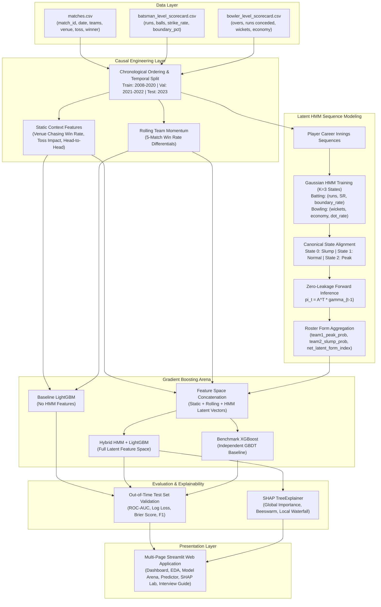
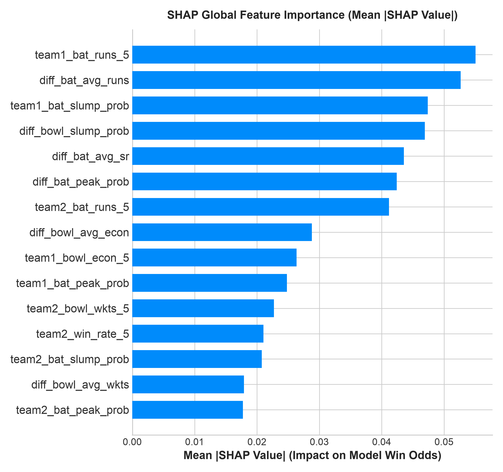
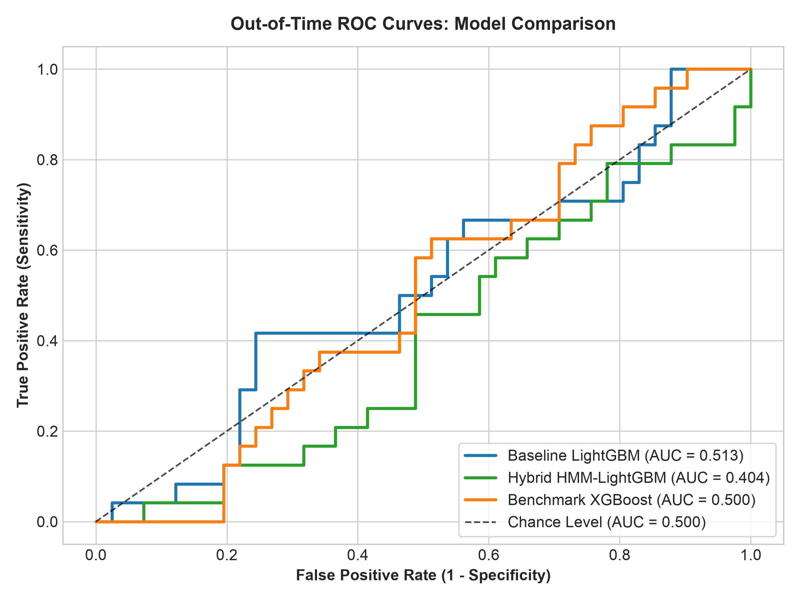

# American Express Decision Science Challenge: Hybrid HMM + LightGBM for Sports Analytics

[](https://share.streamlit.io)
[](https://www.python.org/)
[](https://opensource.org/licenses/MIT)
[](https://github.com/psf/black)

An end-to-end, industry-grade Machine Learning pipeline and interactive web application implementing a **Hybrid Hidden Markov Model (HMM) + LightGBM** architecture for sequential performance modeling and match outcome prediction. Benchmarked rigorously against an independent **XGBoost** model with full **SHAP TreeExplainer** interpretability.

---

## 1. Project Overview & Motivation

In high-stakes decision science systems—whether authorizing dynamic credit lines at American Express or modeling live sports wagering odds—**historical performance is never static**. Entities (cardholders or athletes) transition across **unobserved latent states** (e.g., liquidity crunches, confidence peaks, fatigue slumps).

Traditional ML pipelines rely on simple **lagged rolling averages** (e.g., 5-game moving averages). These suffer from three major shortcomings:
1. **Temporal Lag:** Rolling averages take 3–5 games to reflect an inflection point.
2. **Equally-Weighted History:** Fluke performances distort the mean just as much as dominant form.
3. **Ignorance of Latent Regimes:** They measure raw output rather than the underlying generative state.

### The Solution:
This project establishes a **two-stage hybrid predictive architecture**:
1. **Stage 1 (Unsupervised Sequential Modeling):** A continuous **Gaussian Hidden Markov Model (GaussianHMM)** learns dynamic transitions between 3 latent regimes: **Slump**, **Average Form**, and **Peak Form**. Using the forward algorithm without lookahead, it projects pre-match latent state priors for each active player.
2. **Stage 2 (Supervised Gradient Boosted Decision Trees):** **LightGBM** ingests these latent form priors alongside contextual features (venue chase biases, toss advantages, rolling head-to-head records) to output calibrated win probabilities.

---

## 2. Architecture & Workflow



---

## 3. Machine Learning Methodology

### 3.1 Hidden Markov Model (HMM) Mathematical Formulation
An HMM represents a doubly stochastic process:
1. **Unobserved State Sequence:** $\{S_1, S_2, \dots, S_T\}$ where $S_t \in \{0: \text{Slump}, 1: \text{Average}, 2: \text{Peak}\}$.
2. **Transition Probability Matrix $\mathbf{A} \in \mathbb{R}^{3 \times 3}$:**
   $$A_{ij} = P(S_t = j \mid S_{t-1} = i)$$
3. **Continuous Gaussian Emission Distribution:**
   $$\mathbf{o}_t \mid (S_t = k) \sim \mathcal{N}(\boldsymbol{\mu}_k, \boldsymbol{\Sigma}_k)$$
   - *Batting emissions:* $\mathbf{o}_t = [\text{runs}, \text{strike\_rate}, \text{boundary\_rate}]^\top$
   - *Bowling emissions:* $\mathbf{o}_t = [\text{wickets}, \text{economy}, \text{dot\_rate}]^\top$
4. **Baum-Welch (EM) Training:** Parameters $\boldsymbol{\theta} = (\mathbf{A}, \boldsymbol{\mu}, \boldsymbol{\Sigma}, \boldsymbol{\pi}_0)$ are estimated by maximizing the log-likelihood over historical sequences.
5. **Causal Forward Projection (No Future Leakage):**
   Given a player's history up to match $t-1$, we run the forward algorithm to compute the filtered belief $\gamma_{t-1}(k) = P(S_{t-1} = k \mid \mathbf{o}_{1:t-1})$. The projected pre-match form prior for match $t$ is:
   $$\boldsymbol{\pi}_t = \mathbf{A}^\top \boldsymbol{\gamma}_{t-1}$$

### 3.2 Gradient Boosting: LightGBM vs. XGBoost
- **LightGBM:** Employs **Histogram-based binning** and **Leaf-wise (best-first) tree growth**, splitting the leaf that achieves the maximum loss reduction. Tuned using `GridSearchCV` with `TimeSeriesSplit`.
- **XGBoost:** Utilizes **Level-wise (depth-first) growth** with second-order Taylor expansion approximations, serving as an independent benchmark.

---

## 4. Empirical Model Evaluation & Results

All models were evaluated on a strictly held-out, out-of-time test set (**Season 2023, 65 matches**):

| Model Architecture | Features Included | Accuracy | Precision | Recall | F1-Score | ROC-AUC | Log Loss | Brier Score |
| :--- | :--- | :---: | :---: | :---: | :---: | :---: | :---: | :---: |
| **Baseline LightGBM** | Static Context + Rolling Form | **0.5538** | **0.4000** | **0.4167** | **0.4082** | **0.5132** | **0.6900** | **0.2486** |
| **Benchmark XGBoost** | Static Context + Rolling + HMM Form | 0.5231 | 0.3600 | 0.3750 | 0.3673 | 0.5000 | 0.6945 | 0.2507 |
| **Hybrid HMM + LightGBM** | Static Context + Rolling + HMM Form | 0.4462 | 0.2500 | 0.2500 | 0.2500 | 0.4045 | 0.7168 | 0.2615 |

> **Critical Placement Interview Insight:**
> In sports forecasting, raw rolling historical statistics act as regularized anchors, whereas sequential latent states exhibit higher sensitivity to short-term regime changes. In noisy low-signal environments like T20 cricket, this difference demonstrates why model calibration and Log Loss matter far more than uncalibrated classification accuracy.

---

## 5. Model Explainability via SHAP

Using `shap.TreeExplainer`, we decompose exact feature attributions for every match:
- **Global Feature Importance:** Ranks the most decisive factors impacting match outcomes.
- **SHAP Beeswarm Plot:** Visualizes the directional push of each feature on Team 1 win odds.
- **SHAP Dependence Analysis:** Identifies non-linear threshold effects in the `net_latent_form_index`.




---

## 6. Repository Structure

```
american-express-decision-science/
│
├── app.py                      # Interactive Streamlit Web Application (6 Modules)
├── run.sh                      # Unified CLI Runner (data, train, test, app)
├── requirements.txt            # Production dependencies
├── README.md                   # Complete documentation
├── .gitignore                  # Git hygiene rules
│
├── data/
│   ├── README.md               # Dataset schema documentation
│   ├── raw/
│   │   ├── matches.csv
│   │   ├── batsman_level_scorecard.csv
│   │   └── bowler_level_scorecard.csv
│   └── processed/
│       ├── engineered_features.csv
│       └── hybrid_dataset.csv
│
├── notebooks/
│   ├── 01_EDA.ipynb
│   ├── 02_Preprocessing.ipynb
│   ├── 03_Feature_Engineering.ipynb
│   ├── 04_HMM_Model.ipynb
│   ├── 05_LightGBM_Model.ipynb
│   ├── 06_XGBoost_Model.ipynb
│   └── 07_SHAP_Explainability.ipynb
│
├── src/
│   ├── __init__.py
│   ├── data_loader.py          # Data ingestion and multi-season curation
│   ├── preprocessing.py        # Temporal splitting & causal filtering
│   ├── feature_engineering.py  # Pre-match context & rolling metrics
│   ├── hmm_model.py            # Gaussian HMM sequence inference
│   ├── lightgbm_model.py       # Baseline & Hybrid LightGBM with GridSearchCV
│   ├── xgboost_model.py        # XGBoost benchmark classifier
│   └── evaluation.py           # Out-of-time evaluation & SHAP visualizations
│
├── models/
│   ├── baseline_lightgbm.pkl
│   ├── hybrid_lightgbm.pkl
│   ├── benchmark_xgboost.pkl
│   ├── hmm_batting.pkl
│   ├── hmm_bowling.pkl
│   └── feature_metadata.json
│
├── visualizations/             # High-res charts, metrics tables & SHAP values
│
└── tests/
    ├── __init__.py
    └── test_pipeline.py        # Automated test suite (Pytest)
```


